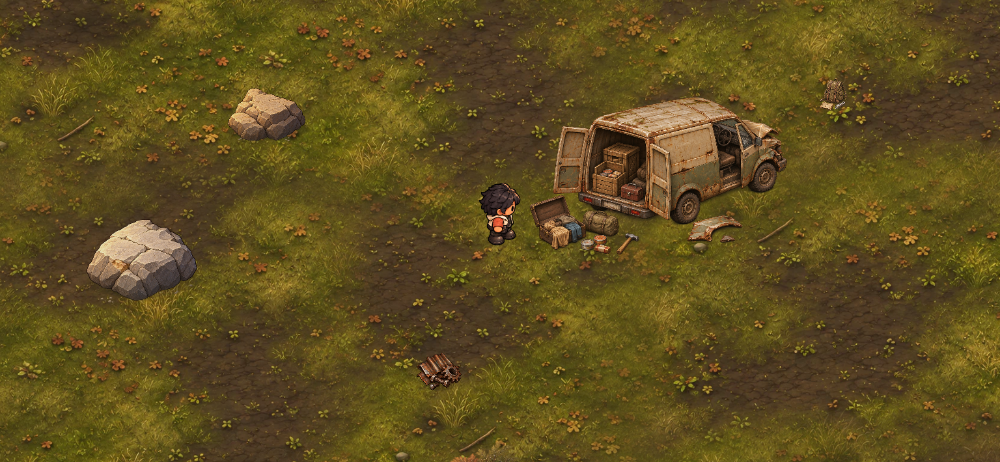

# Evacuation van

The wreck is placed south of camp at `(1000, 5400)`. A separate abandoned
backpack sits northeast of it at `(1300, 5200)`. The overview map labels the
wreck **Evacuation van**.

The open cargo contains two tins of beans, two energy bars, a repair hammer,
a wooden axe and five scrap. The backpack contains one tin of beans, one
energy bar and two scrap. Both use the existing finite loot inventory and
save system, respect carrying capacity and keep partially collected supplies.
The van chassis and doors block movement; spilled belongings and the backpack
are walkable. The owner can move, transform, copy or remove either prop.

Existing worlds receive the pair once, with surveyed fallback sites if the
primary clearing is occupied. The migration preserves other placements,
publication timestamps, saved loot and subsequent owner edits. Both textures
are bundled for offline native use.

## Verification

- Web and native TypeScript checks passed.
- The production web build passed.
- `scripts/check-evacuation-van.mjs` passed placement, migration, pathfinding,
  transformed search access, map labels and continued-run safety checks.
- `scripts/check-evacuation-loot.mjs` passed search, capacity, independent
  inventories, web/native save round trips and existing chest timing checks.
- Existing abandoned woodland chest checks passed.
- Smallholding placement and renderer checks passed after incorporating
  upstream commit `4ce4f8e`.
- Six production native Skia views verified transparency, ground contact,
  collision, front/behind depth and both search approaches. Visible terrain
  had no missing textures. This used a software native adapter, not a
  physical iPhone.

The unrelated player-map path batch limit already fails on the starting
baseline. The preceding main CI run also fails in the co-op test's Node mock
setup at `scripts/check-coop-room.mjs:84`; neither is changed by this update.
