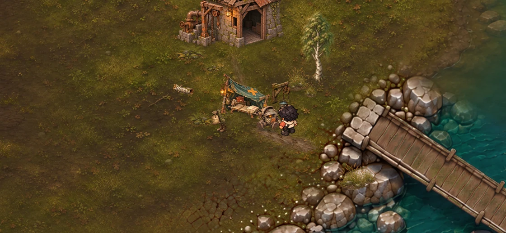
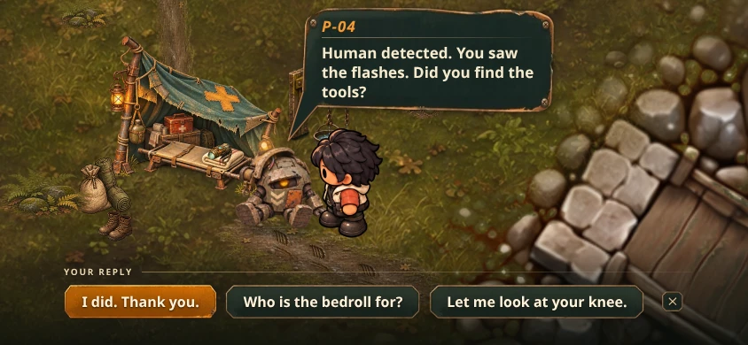
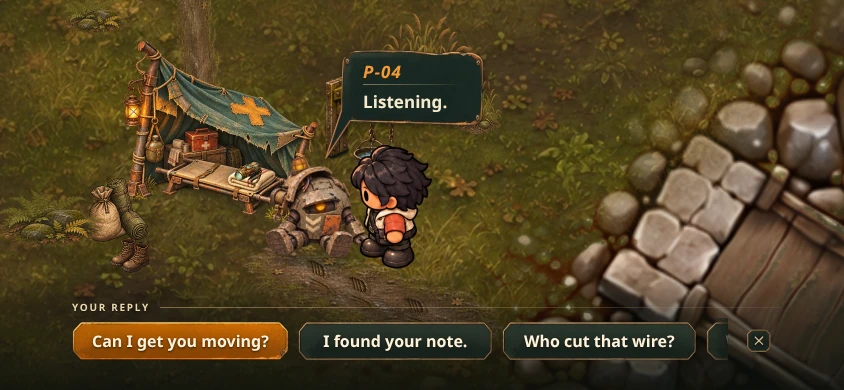
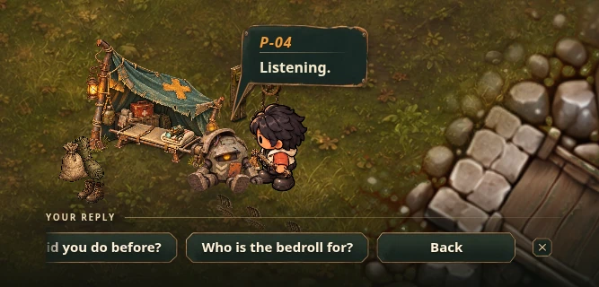
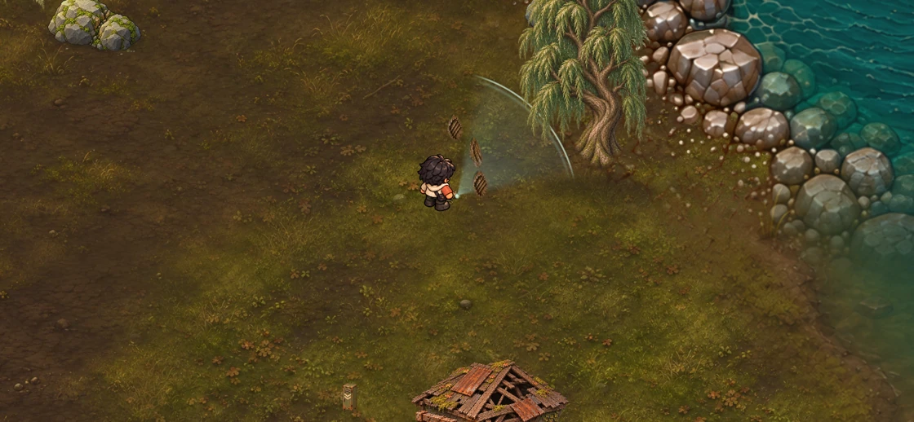
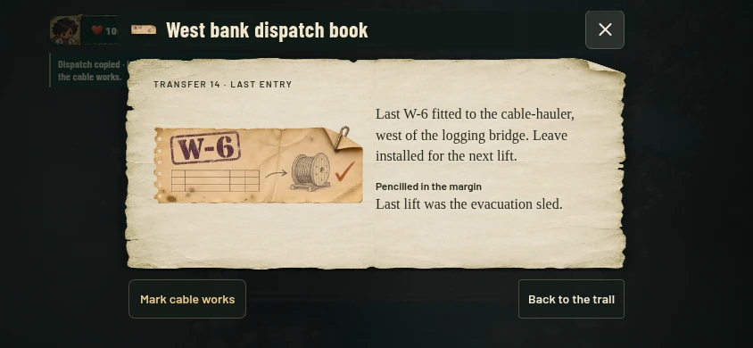
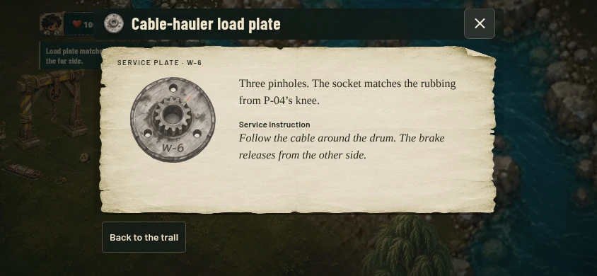
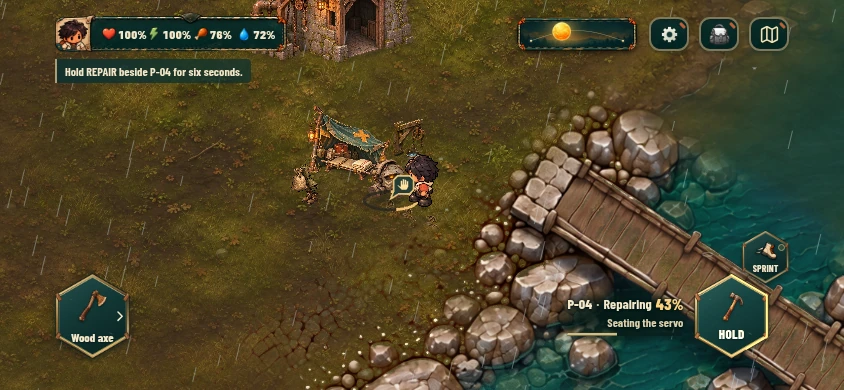
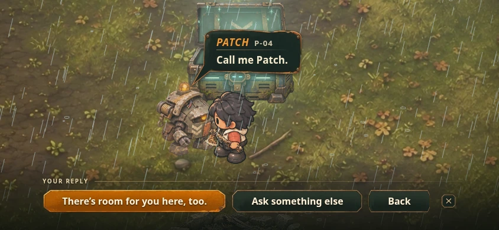
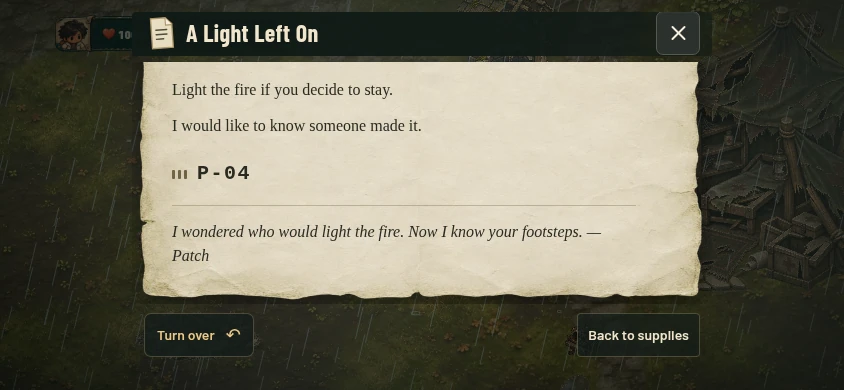

# A Light Left On

## First contact

From the bridge, a muddy track leads past the wet hoist towards the sheltered cot. This frame uses the outdoor Skia renderer and ordinary walking zoom.



P-04 asks whether the survivor found the tools. His reply depends on what the survivor took from the camp chest and whether they read his letter. The dry bedroll opens a personal conversation. Looking at his knee starts the search for a W-6 drive.



The optional questions stay in one horizontal row. On a 667 × 320 landscape screen a touch swipe reached the last of six choices and returned to the beginning. The close target stayed at 44 × 46 points. The two 844 × 390 conversation captures used a separate session at the shelter to show the final interface.





## Following the evidence

The scanner starts with the deep right tread and the scrape from P-04’s left toe. Dry boards interrupt the tracks at a bridge. Beyond the dispatch post, twin sled runners and broad crawler cleats lead toward the cable works. A player can also ask him to mark the post or recover the lead in the journal.



The survivor copied Transfer 14 at the post, read the load plate at the works and released the drive on the opposite side of the drum. The southern service approach kept the pack far enough away to inspect the plate at full health.





## Getting him home

“You can borrow mine” hands control back to the survivor. Holding the repair action for six seconds seats the drive. P-04 then gets up and can accept the invitation to walk back together.



The pair made it back to the original camp chest on day two with the survivor at 100 HP. It contained two logs and two metal scrap. The speaker still read P-04 when he started his introduction. Advancing to “Call me Patch” changed the speaker plate and saved his chosen name.



Reopening the folded note after the introduction revealed the signed postscript. The survivor could also turn back to the sketch and revisit the gate memory.



## Test conditions

The campaign used a fresh survival expedition in Chromium, landscape touch controls and read-only route guidance. Wildlife, damage, resources and quest flags ran normally. Compact and safe-area checks used 667 × 320 and 844 × 390 layouts. The first contact, question list and plate close-up were also reopened in a separate session for the gallery. The outdoor shelter and scanner frames use the shared Skia renderer at landscape phone scale.

The trail model and both renderers have dedicated regression checks. Run these from the repository root after installing the web and native dependencies.

```sh
node scripts/check-patch-scanner.mjs
node scripts/check-patch-scan-render.mjs
node scripts/check-patch-quest.mjs
node scripts/check-patch-dialogue.mjs
```

Three broader checks also fail on the original `0cdcf9b` revision. The expedition test assumes the starter axe is the only carried weight. The camp predator test expects cooked food on an older rack. The gameplay artwork test expects a different first-wave preload. The dedicated quest, wolf hunt and scan rendering checks cover the changed behavior here.
