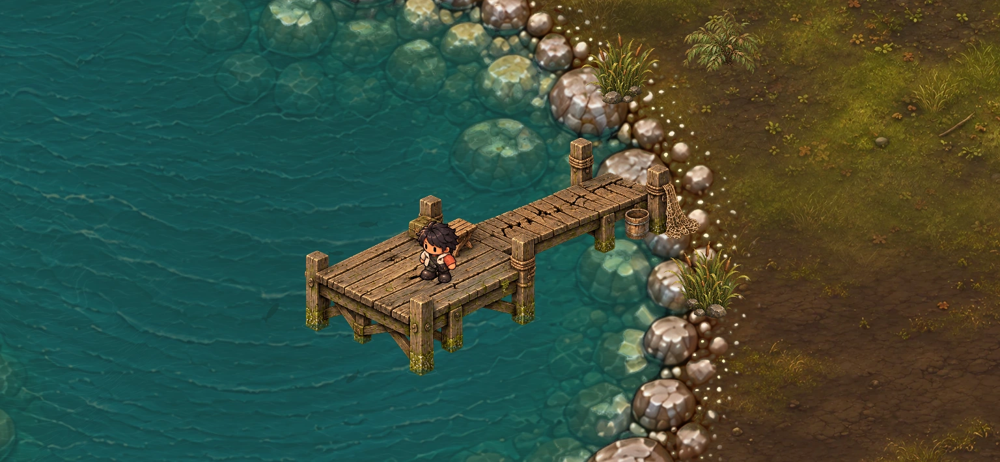
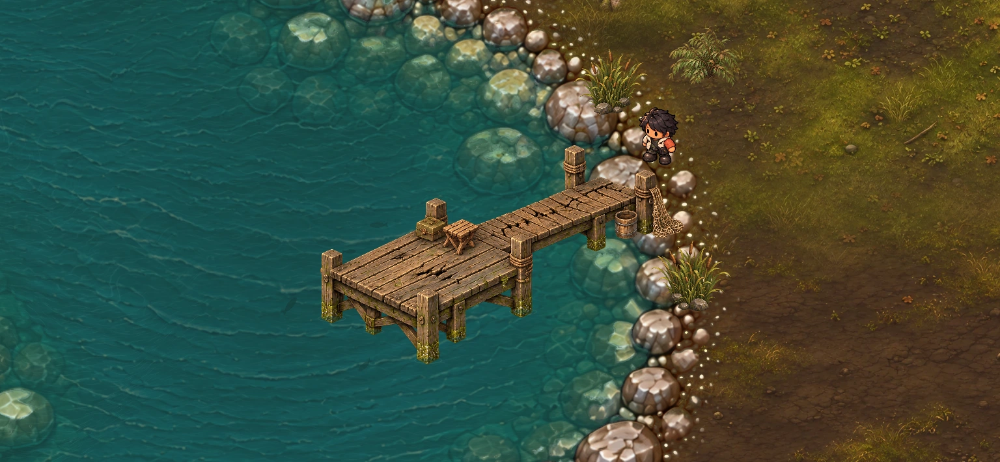

# Stillwater Lake: visual fishing site

The first fishing location occupies the existing lake southwest of camp. Its bank-end anchor is **(-1470, 6500)**. The player map marks the site with a fish and the name **Stillwater Lake**.

## Shipped in this phase

- Transparent weathered timber jetty, stool, tackle box, bucket and net, matching the approved concept.
- A 740-world-unit-wide pier with an accurately traced walking surface, separate post/prop collision and foreground depth.
- Two larger reed clusters on the bank, subdued woodland-green lake water, and small water-contact rings at submerged support tips.
- Five swimming fish silhouettes with deterministic orbits and occasional ripples. Routes remain entirely in existing water. Fish and water contacts are culled offscreen; reduced motion freezes fish and suppresses their ripples.
- Fresh, continued, published and offline native layouts include the site. Existing placement data, inventory and publication timestamps are retained. Owner moves and deliberate deletions are respected.
- Both new textures are explicitly bundled for offline native use and remain available to the editor.

Casting, bites, reeling, catching and fishing inventory are reserved for the next gameplay phase.

## Verification

`check-fishing-site.mjs` checks placement and fallbacks, capacity, owner edits/deletions, existing scenery, a dry route from camp, real water beneath the deck, shared/native map labels, Continue inventory, published migration, active artwork replacement and offline cached owner metadata.

`check-fishing-site-behavior.mjs` exercises full-radius water support, seven blocked wet edges, all existing bridges, transformed placement geometry, actual movement in both directions between land and deck, water-only fish routes, reduced motion, culling and software-Skia foreground occlusion. The narrow gangway uses bounded local routing with a 21-unit planning radius for the player's 19-unit body; the global navigation grid is unchanged.

Web and native TypeScript checks, the web production build, the evacuation-loot regression and native map rendering checks passed. The production native renderer loaded the scene entirely from packaged artwork, with zero missing textures in both captured views. These are actual renderer captures through platform adapters, not a physical iPhone test.

## Captures

Machine-readable results are in [checks.json](checks.json).
